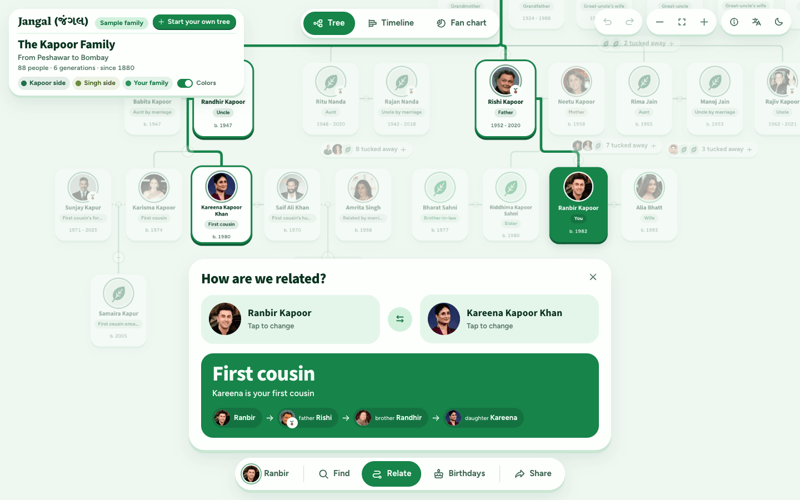

# Jangal (જંગલ) - The Family Forest

A family tree app that runs entirely in your browser. Add people with a photo, names, dates, and
notes, connect them as parents, partners, children, and siblings, and explore the tree. Hover over
someone to light up their immediate family. Search for anyone to fly to them, see the path from
you to them, and get the answer in plain words: "Kareena is your first cousin." There's no account
and no server. The tree is saved in the browser, and nothing leaves the device unless you export
it.

Jangal is Gujarati and Hindi for forest. It's the old joke about Indian families: we don't have a
family tree, we have a family forest.

<picture>
  <source media="(prefers-color-scheme: dark)" srcset="docs/screenshot.png">
  
</picture>

The app is the site's front page, at `/`. Its start screen says what Jangal is, and it's built to
be found in search and to preview well when shared. Old links to `/app/` still open it. Next to it
are two small static pages, `/privacy/` and a 404 page. There was a separate landing page, and it
was removed on purpose. The full product and technical plan is in
[PLAN.md](PLAN.md). The thinking
behind it, the library choices, and the bugs that came up along the way are in
[WALKTHROUGH.md](WALKTHROUGH.md).

## Features

- **Build the tree where you look.** Each tile has buttons to add a parent, partner, child, or
  sibling, and the new tile opens into a small card for their name, gender and birthday. A second
  parent or a partner starts with a guessed gender, one click to change. The tree holds still
  while you type, and shows the new person once they're added. You can link people who are already in
  the tree, and deleting someone first shows exactly who goes with them. Every change can be
  undone, up to 200 steps back.
- **Real families.** Adoption, step, and foster children, divorce and remarriage, half siblings,
  same sex couples, and unknown parents. Dates can be partial ("1946", "March 1971"), wedding
  days included. Where someone lives now goes on their card.
- **Pets.** Add the family's dog or cat to their owners. A pet gets a paw, is named from its owners
  ("Your dog", "Your first cousin's cat"), and is counted apart from people.
- **Relationships in plain words.** Every tile says how that person is related to you: aunt,
  first cousin, uncle by marriage, your uncle's former wife. Marking yourself is optional. With no
  one marked, the tree is shown neutrally, with no one at the center.
- **Gujarati and Hindi family titles.** The translate button switches the words on tiles and cards
  to what your family says: Pappa, Kaka, Foi, Masi, Bhabhi, or Papa, Chacha, Bua, Mausi. Each
  relationship offers its variants (Pappa, Papa, Bawa or Bapuji), and words that depend on age,
  like Bapa or Didi, come from birthdays. Edit words adds, removes and reorders any language's
  words, and New language builds another one step by step, or from a JSON or spreadsheet template.
  Anyone can also have a title of their own ("Moti Ba"), for the whole family or just for you. A
  backup or family page carries the words along. The details are in
  `src/core/titles.ts`.
- **Explore.** Hover to light up someone's parents, partners, and children. Find (`/`) is a
  fuzzy search that flies to the person and lights the path from you. "How are we related?" takes
  any two people and shows the answer with every hop in between.
- **Traits.** Tag people with traits like "Black hair", "Left-handed" or "Musical". Find lists the
  family's traits, and picking one lights everyone who has it, the lines it ran down from parent to
  child, and anyone it skipped a generation to.
- **Branch colors.** Your father's side, your mother's side, and your own family each get a shade.
  In the neutral view the shades follow the founding lines instead.
- **Tuck branches away.** Hide a family's descendants or a person's ancestors when you don't need
  them. Searching for someone in a tucked away branch opens it again.
- **Arrange brothers and sisters.** Press and hold a tile, then drag it left or right among its
  brothers and sisters (aunts and uncles too), or use Alt+arrows. The family keeps that order in
  every view and export, and "back to birth order" undoes it.
- **Three views.** The Tree, a Timeline of lifespans with "Watch the family grow", and a Fan chart
  of anyone's ancestors.
- **Birthdays.** A month by month calendar with upcoming birthdays and wedding anniversaries, and
  an `.ics` file for Apple or Google Calendar.
- **A title for every tree.** "The Alvarez & Raman Family" is suggested from the surnames, and you
  can rename it in place. Exports and file names lead with it.
- **Share and export.**
  - *A page for family:* one HTML file that opens anywhere, even offline, with no network
    requests. Relatives can pick who they are, and it can hide the birthdays, notes, and photos
    of people who are living.
  - *Poster PDF:* the whole tree from Letter up to 24 by 36 inches, with optional profile pages.
    The text is real text, so it can be searched and copied.
  - *Picture:* PNG or SVG.
  - *Backup file:* everything, photos included, as a `.jangal.json` file that loads back in.
  - *Spreadsheet:* one row per person, with parents and partners, as an Excel file (with
    dropdowns and an instructions tab) or as CSV. It imports back in.
- **Import.** A backup, a family page someone sent you, a GEDCOM file from Ancestry,
  FamilySearch, or MyHeritage, or a spreadsheet (.xlsx or .csv). There's a template to fill in, with an example
  family. You see what's in the file before anything changes, row by row for a spreadsheet.
- **Combine two trees.** Add a file a cousin sent, or another tree in this browser, to the open
  one. You tick who is in both, they become one person, everyone else is added, and anything that
  doesn't line up is listed. One Undo takes it all back.
- **Several trees** in one browser. "New tree" at the top of the title pill starts another one
  (in the sample family it reads "Start your own tree"), the tree you leave stays saved, and
  Undo in the toast goes straight back to it. The Share sheet lists every tree.
- **Keyboard first.** Arrows move to a parent, child, sibling, or partner. `E` edits, `A` adds a
  relative, `R` asks how you're related, `H` tucks a branch away, `1` `2` `3` switch views, and
  Alt+arrows move a tile among its brothers and sisters, and `?` lists them all.
- **Light and dark themes.** Leaf greens on white, and a dark Bark theme of deep greens and
  browns.
- **Works offline and installs as an app.** A service worker keeps a copy of the app, and a new
  version waits until you choose to reload.

## Tech stack

- React 19, TypeScript, and Vite 8
- Tailwind CSS v4, with all colors as CSS custom properties in `src/styles/tokens.css`
- React Flow (`@xyflow/react`) for pan, zoom, pinch, and culling on the tree. The layout and the
  connectors are the app's own
- Zustand with Immer for state, and zundo for undo and redo
- IndexedDB through `idb-keyval` for storage
- Zod to check imported files, loaded only when a file is imported
- Fuse.js for fuzzy search
- jsPDF and svg2pdf.js for the poster, loaded only when you make one
- react-easy-crop for photos
- Phosphor icons, and Source Sans 3, Figtree, and Noto Sans Gujarati from Fontsource,
  self hosted
- vite-plugin-pwa (Workbox) for the service worker, and vite-plugin-singlefile for the family page
- sharp and harfbuzzjs at build time, for images and for the wordmark
- Vitest for unit tests, Playwright 1.48 with axe-core for end to end and accessibility tests,
  size-limit and Lighthouse CI for the budgets, and oxlint

## Project structure

```
index.html                       The app's page, at "/"
app/index.html                   Sends old links to /app/ on to "/", query and all
privacy/, 404.html               The static pages, rendered to HTML at build time
viewer.html                      The family page template (a separate, single file build)
PLAN.md                          The product and technical plan
WALKTHROUGH.md                   How it was built and why
deploy/headers.json              Security and cache headers for every host
netlify.toml, vercel.json        Host settings (headers are written into them by `npm run hosts`)
.github/workflows/               checks.yml for every pull request, pages.yml for GitHub Pages
.lighthouserc.cjs                Lighthouse CI budgets
.size-limit.mjs                  Size budgets
og/template.html                 The link preview image, rendered by `npm run og`
mockups/                         Design mockups: the final design (07) and the F8–F19 feature mockups
CLEAN-UP/                        Files no longer used, kept for review before deleting (see its README)
docs/                            README screenshots (not shipped with the site)
scripts/
  prerender.mjs                  Renders the public pages to HTML, inlines their CSS, adds JSON-LD
  build-seo.mjs                  robots.txt, the sitemap, the Content Security Policy, noindex on previews
  finish-viewer.mjs              Hashes the family page's scripts into its CSP
  ensure-viewer.mjs              Builds the family page template before `npm run dev` if it's missing
  build-wordmark.mjs             Turns "Jangal (જંગલ)" into SVG paths with HarfBuzz
  build-og.mjs, build-screens.mjs, build-icons.mjs   The preview image, the README screenshots, the icons
  fetch-pdf-fonts.mjs            Downloads the TTF fonts the PDF embeds
  build-sample-photos.mjs        Fetches the sample family's free photos from Wikimedia Commons (run by hand)
  gen-host-config.mjs            Writes deploy/headers.json into netlify.toml and vercel.json
src/
  brand.ts                       The name, the script, the About text, and the file name slug
  core/                          Pure TypeScript, no React, all unit tested
    model.ts                     People, families, and the tree document
    index.ts                     The graph index: parents, children, partners, siblings
    kinship.ts                   Relationship labels in plain words
    titles.ts                    Family titles (Kaka, Foi, Masi): which relationship fits, and the words
    titles/                      en.json (the relationships), gu.json and hi.json (the words), pack files
    traits.ts                    Traits: who has one, and how it ran through the family
    sheet/                       Spreadsheets: CSV and Excel read and written, rows to a tree and back
    path.ts                      The shortest path between two people
    sides.ts                     Which branch color each person gets
    collapse.ts                  Tucking branches away
    layout/layout.ts             The tree layout
    edit.ts                      Adding, linking, editing, and removing people
    merge.ts                     Combining two trees: who is in both, and joining them
    title.ts, dates.ts, search.ts, calendar.ts
    schema.ts, migrate.ts, importTree.ts, treeFile.ts   The backup format, its checks and migrations
    gedcom/                      The GEDCOM parser, date reader, and mapping
    sample.ts                    The sample family: the Kapoor family of Hindi cinema, with the Bhatts and Bachchans
    sampleCredits.json           Who took each sample photo, and its license (written by a script)
  store/                         The tree store (with undo), UI state, settings, saving, and photos
  app/                           The app shell, the start screen, startup, actions, shortcuts, and derived data
  features/
    canvas/                      The Tree tab: tiles, quick add, connectors, hover, path and trait emphasis, the camera
    chrome/                      The title pill, tabs, buttons, and the dock
    person/                      The person card, the edit form, adding relatives, photos
    search/, related/, birthdays/, about/   The sheets in the dock and the About sheet
    titles/                      The Family titles sheet, its word editor, and New language
    timeline/, fan/              The Timeline and Fan chart tabs
    export/, import/             Sharing, the PDF and picture renderers, importing, and combining trees
    sheets/                      The sheet frame, the people picker, and "Who are you?"
  site/                          The privacy and 404 pages, and the server render entry
  viewer/main.tsx                The family page's entry point
  styles/                        Tokens and the app's CSS
  ui/                            The avatar, the wordmark, and the icon list
tests/
  e2e/                           Playwright tests, accessibility scans included
  fixtures/                      Test families (alvarez.ts is the first sample family), and GEDCOM files
```

## Getting started

Requires Node.js 22 or newer (`.nvmrc` pins 24, which the hosts use).

```bash
npm install
npm run dev
```

The dev server runs at `http://localhost:5190`, and the app is at `/`. Open `/?sample` to load the
sample family.

The end to end tests need Playwright's Chromium. Playwright is pinned to 1.48, the last version
that supports macOS 12, so install the browser with the same version:

```bash
npx playwright@1.48 install chromium
```

## Scripts

- `npm run dev` starts the Vite dev server
- `npm run build` builds everything into `dist/`: the family page template first, then a type
  check, the app and the static pages, the static render of the privacy and 404 pages, and the
  search and security files
- `npm run preview` serves the production build at `http://localhost:5199`
- `npm test` runs the unit tests (Vitest)
- `npm run e2e` builds, serves, and runs the Playwright tests, including axe accessibility scans
  in both themes and at phone width
- `npm run lint` runs oxlint
- `npm run size` checks the size budgets against the last build
- `npm run lhci` runs Lighthouse CI against the last build
- `npm run wordmark`, `npm run og`, `npm run screens`, and `npm run icons` regenerate the
  wordmark, the preview image, the README screenshots, and the app icons
- `npm run icon-paths` writes the drawings of the interface icons listed in `src/ui/icons.ts`
  (bold, and fill where asked) into `src/ui/icons.gen.ts`; run it after adding an icon
- `npm run hosts` writes the headers in `deploy/headers.json` into `netlify.toml` and
  `vercel.json`

## Deploying

The same `npm run build` works on all three hosts, and nothing in `src/` knows where it's hosted.
Set `SITE_URL` to the site's address (for example `https://jangal.family`) in the host's
environment settings. Canonical links, the sitemap, and the preview tags use it. Without it, the
build falls back to Netlify's `URL` or Vercel's `VERCEL_PROJECT_PRODUCTION_URL`, and a build on a
host with no address at all fails rather than point those tags at localhost. Set `VITE_REPO_URL`
to show a GitHub button in the app. Without it, the button isn't shown.

- **Netlify** (the main host): connect the repository. `netlify.toml` sets the build, the
  headers, and the Lighthouse plugin. Deploy previews are built for pull requests, and they're
  never indexed: their robots.txt blocks crawlers and every response says `noindex`.
- **Vercel:** connect the repository. `vercel.json` sets the framework, trailing slashes, and the
  same headers.
- **GitHub Pages:** in the repository's Settings, under Pages, set the source to GitHub Actions,
  and add a repository variable `SITE_URL`. `pages.yml` builds on every push to `main`. A project
  site lives under `/<repo>/`, so the workflow passes the repository name as `BASE_PATH`. With a
  custom domain, set the variable `BASE_PATH` to `/`. Pages can't send headers, so the Content
  Security Policy also ships as a `<meta>` tag on every page.

## Pages and addresses

- `/` is the app. It's indexed, with a title, a description, JSON-LD, and the start screen's words
  in its `<noscript>`, so search engines and link previews can read it.
- `/app/` is a tiny page that opens `/` with the same query, so old links and `/app/?sample` still
  work on every host, GitHub Pages included. It's marked `noindex`.
- `/privacy/` and the 404 page are static HTML, with no JavaScript bundle.
- The sitemap lists `/` and `/privacy/`, and Lighthouse CI checks both.

## Privacy

Trees are stored in the browser's IndexedDB. The app asks the browser to keep that storage
(`navigator.storage.persist()`), offers a backup download if saving ever fails, and never uploads
anything. There are no analytics, tag managers, font CDNs, or embeds, and the Content Security
Policy only allows the site's own files. The family page export makes no network requests at
all: its policy is `default-src 'none'`, with its scripts allowed by hash and its fonts and photos
inlined.

## Performance

Budgets, checked by `npm run size` (compressed with Brotli):

| What | Budget | Now |
| --- | --- | --- |
| The app's HTML page | 10 KB | 2 KB |
| Privacy page HTML with its CSS inlined | 25 KB | 6.6 KB |
| App JavaScript on first load (16 files) | 200 KB | 159 KB |
| App CSS | 25 KB | 13.4 KB |
| Fonts, Latin only | 70 KB | 61.5 KB |

The privacy and 404 pages send no JavaScript at all. In the app, the sample family, the Timeline
and Fan chart tabs, the person card,
every sheet, the PDF and picture renderers, GEDCOM import, the photo cropper, and the search
index load the first time they're used.

Lighthouse mobile, measured locally with Lighthouse CI on a 2015 MacBook Pro on 2026-10-09:

| | Privacy page | App at `/?sample` (88 people, 24 shown at first) |
| --- | --- | --- |
| Performance | 100 | 88 (64 in one run during a load spike) |
| Accessibility | 100 | 100 |
| Best practices | 100 | 100 |
| SEO | 100 | 100 |
| Largest Contentful Paint | 1.1 to 1.2 s | 3.2 s |
| Total Blocking Time | 0 | about 0.15 s |

The demo opens mostly tucked away: Ranbir's own line, with each cousin's branch and the Bhatts
behind a pill. What got it from the high 50s to 88:
- The title, tabs and dock paint a frame before the tree.
- Nothing measures the page while the tree is first drawn, and the camera's first position is
  worked out before the canvas mounts, so tiles are drawn once.
- The demo's photos wait for the tree: the faces on screen first, the rest when the browser is idle.
- The demo is saved, and the service worker starts, once the tree is showing.

Total blocking time swings with how busy the machine is.

The app doesn't yet meet its performance target of 90 or more
and an LCP under 2.5 s, so `.lighthouserc.cjs` and the Netlify Lighthouse plugin will report it
until it does. What's left is mostly the cost of starting React and React Flow on a slow phone.
[WALKTHROUGH.md](WALKTHROUGH.md#speed) covers what was tried.

## Name and branding

The name, the Gujarati script, the subtitle, the About text, and the file name slug all live in
`src/brand.ts`. The wordmark is an SVG generated from it by `npm run wordmark`, so the display
fonts are never downloaded.
