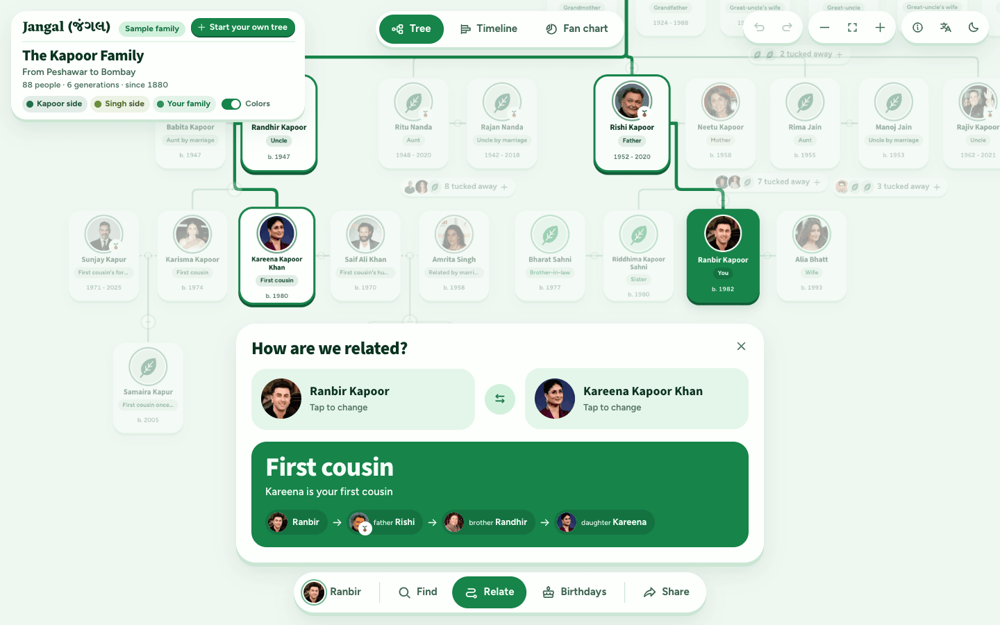
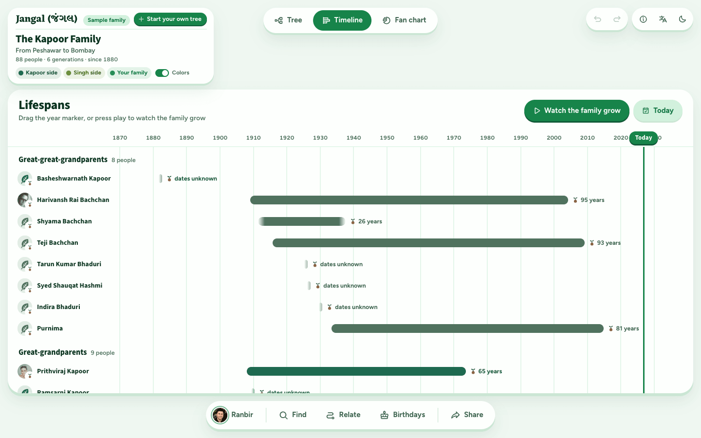
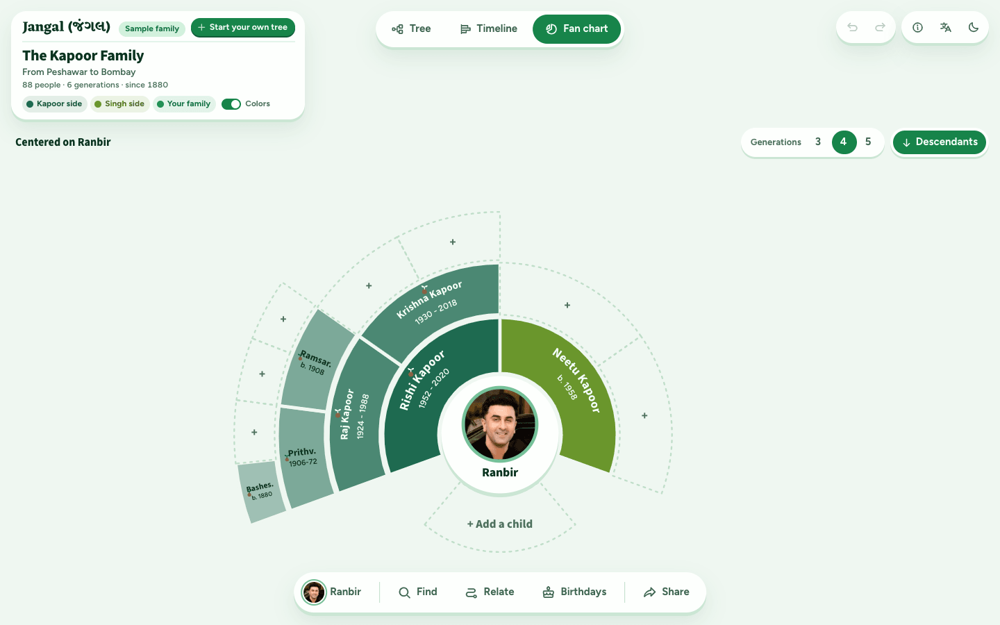
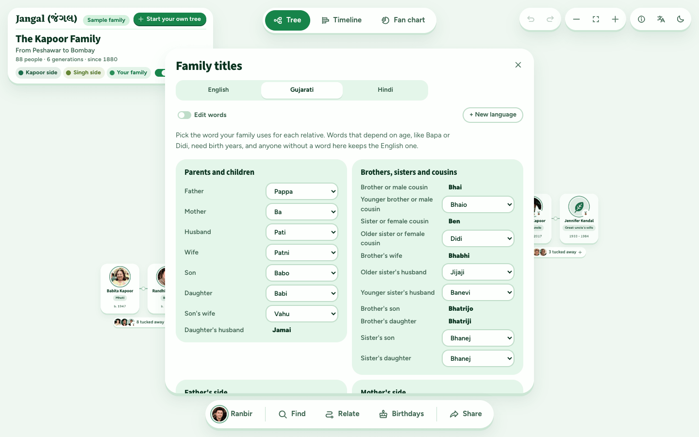
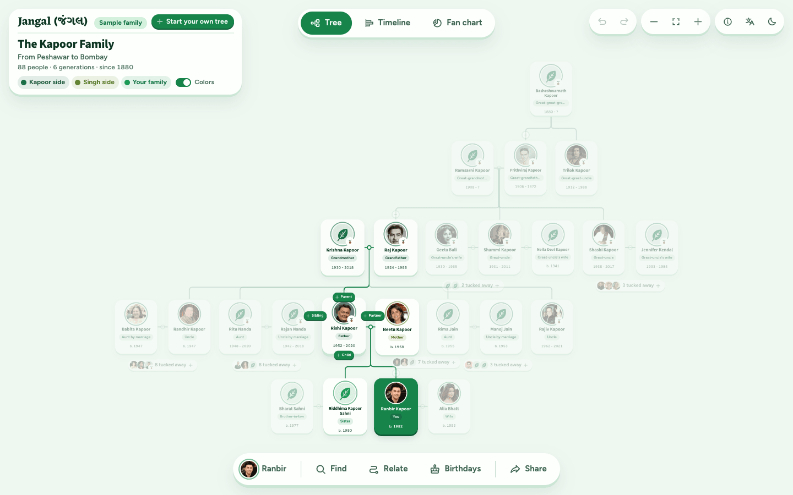
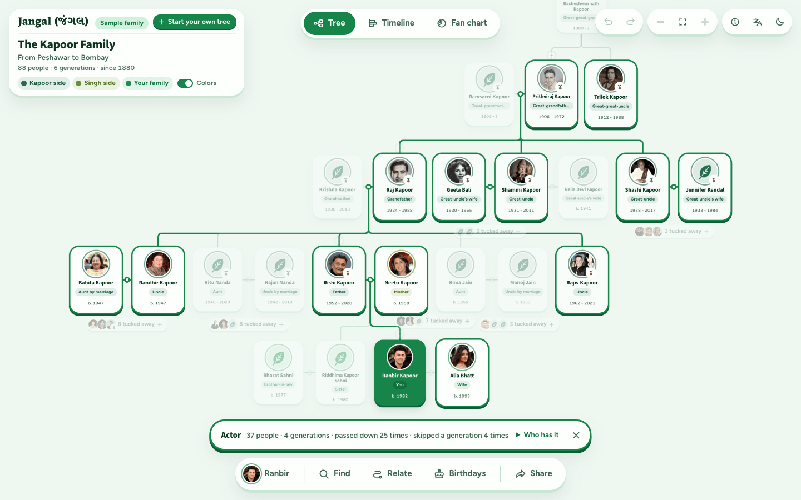
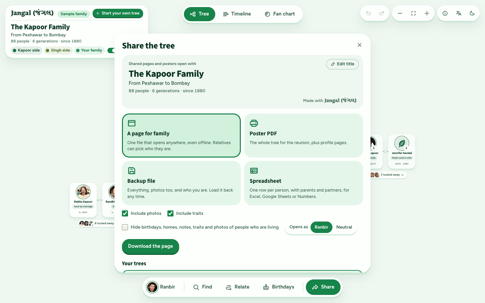

# Project Walkthrough: Jangal (જંગલ) - The Family Forest

This document is meant to help explain the project out loud, for example in an interview. It
covers what the app does, why it was built the way it was, the reasoning behind each library
choice, the interesting technical problems, and the bugs that were caught along the way.

## What the project is

Jangal is a family tree app that runs in the browser. You add people with a photo, names, dates,
and notes, and connect them as parents, partners, children, and siblings. Then you explore: hover
over someone and their immediate family lights up, search for anyone and the app flies to them and
lights the path from you, and ask "How are we related?" about any two people and get the answer in
plain words, with every hop in between: Maya, her mother Priya, Priya's brother Arjun, his daughter
Anika. Anika is Maya's first cousin.

There are three views of the same family (the tree, a timeline of lifespans, and a fan chart of
ancestors) and a dock of tools that work in all of them: search, relationships, birthdays, and
sharing. Sharing produces a single HTML page relatives can open offline, a print ready PDF poster,
a picture, or a backup file. It also imports GEDCOM, the format Ancestry, FamilySearch, and
MyHeritage export, so nobody has to type an existing tree in again.

<table>
<tr>
<td width="50%">

</td>
<td width="50%">

</td>
</tr>
</table>

The name is a family joke. Jangal is Gujarati and Hindi for forest, and Indian families don't have
a family tree, they have a family forest.

## Why it is built this way

**No server.** A family tree is private, personal data, and the app doesn't need a server to do
anything it does. Keeping everything in the browser means there are no accounts, nothing to
breach, nothing to pay for as it grows, and it deploys as static files to Netlify, Vercel, or
GitHub Pages. The tree lives in IndexedDB. The cost is that the browser holds the only copy, so the
app asks the browser to keep its storage, makes backups one click away, and offers a backup
download if saving ever fails.

**Store facts, derive relationships.** The data model only stores two kinds of fact: these people
are partners (a family), and this person is a child of this family. Siblings, cousins, in-laws, and
"second cousin once removed" are never stored. They're computed from the graph whenever they're
needed. That keeps the data impossible to contradict itself: there's no way to record two people as
siblings who don't share a parent.

**A website and an app, kept apart.** The landing page is there to be found in search and to
preview well when someone shares the link. Those jobs want plain, fast HTML. The app wants
JavaScript. So the public pages are React components rendered to static HTML at build time with no
JavaScript sent, and the app lives at `/app/` as its own page. The app is marked `noindex`, because
everyone's tree is different and none of it belongs in search results.

## Tech stack and why each piece was chosen

**React 19 and TypeScript.** Vue would have worked too, and the plan records the comparison. React
won because the rest of my projects use it, and because the riskiest pieces, the canvas in
particular, have their reference libraries in React. TypeScript matters more than usual here:
the relationship engine, layout, and GEDCOM mapping are full of small structures that depend on
each other, and the compiler catches a wrong field or a missing case before it becomes a wrong
label on someone's grandmother.

Most of the code isn't React at all. Everything under `src/core/` (the graph index, relationship
labels, paths, branch colors, collapsing, the layout, dates, GEDCOM, the file format) is plain
TypeScript with no framework, which is what makes it easy to test.

**Vite 8.** Fast in development, and good at the build this project needs: four HTML entry points
(the landing page, privacy, 404, and the app), a second build for the single file family page, and
a server render of the public pages. Rolldown's code splitting groups put React in its own file,
so a deploy that only changes the app leaves it cached.

**React Flow.** Pan, zoom, pinch, keyboard focus, and only drawing the tiles on screen are hard to
get right on every device, and React Flow does all of them well. It doesn't decide where anything
goes, though. The layout is the app's own, and so are the connectors. Every person is a node at a
position the layout chose, and all the connecting lines are one SVG node underneath them.

**Zustand, Immer, and zundo.** Zustand keeps the tree in a store that components read with
selectors, so a change re-renders only what reads it. Immer makes edits read as plain mutations
and, more importantly, keeps every object that didn't change as the same object. That turns out
to be the key to caching (see "The graph index" below). zundo adds undo and redo on top, limited
to the tree document, so moving the camera or opening a sheet is never an undo step.

**idb-keyval.** IndexedDB with a tiny API. Trees and photos are stored as separate keys, so saving
an edit never rewrites every photo.

**Zod.** Checks any file that's imported, migrates old versions forward, and generates the JSON
Schema published at `/schema/v1.json`. It's only loaded when a file is imported.

**Fuse.js** for fuzzy search, so "anka" finds Anika. **jsPDF and svg2pdf.js** for the poster,
**react-easy-crop** for photos. All three load only when they're used.

**Phosphor icons and Fontsource fonts.** Icons are listed one by one, and a script keeps only the
drawings the app uses: bold, plus fill for two (Phosphor's modules carry six weights each). The fonts (Bricolage
Grotesque for display, Figtree for text, Noto Sans Gujarati) are self hosted, Latin only by
default, with the other subsets loading only when those characters appear. Nothing comes from a
third party, which keeps the privacy promise and is also the single biggest speed win.

**Tailwind CSS v4.** Every color is a CSS custom property defined once in `tokens.css`, in a
light set and a dark Bark set. Components read the variables, so a theme change is one file.

**Playwright 1.48, axe-core, Vitest, size-limit, and Lighthouse CI.** Unit tests cover the core,
end to end tests cover the main stories, axe scans every screen in both themes and at phone width,
and the budgets fail a pull request that makes the first load heavier. Playwright is pinned to 1.48
because my Mac runs macOS 12, which newer versions don't support.

## The graph index

Almost everything in the app asks the same questions: who are this person's parents, children,
partners, siblings? `src/core/index.ts` builds an index that answers them, once per change.

The trick is when "once per change" happens. Because Immer keeps unchanged objects identical, the
index is cached in a `WeakMap` keyed on the tree's `people` and `families` objects. Renaming the
tree, or changing who's marked as you, produces a new document but the same `people` and
`families`, so the index (and everything derived from it, like the layout) is reused. Editing a
person produces a new `people` object, and the index is rebuilt. No manual invalidation anywhere.

## Relationship labels

`src/core/kinship.ts` turns a pair of people into words. It works in three passes:

1. **Blood.** Find the closest common ancestor and count the generations down each side. One
   generation each way is a sibling, two each way is a first cousin, and an uneven count gives
   "once removed", "twice removed", and so on. Going straight up gives parent, grandparent, great
   grandparent. Sharing only one parent gives a half sibling.
2. **One marriage away.** If there's no blood link, try one partner hop on either side. That
   covers in-laws (your partner's brother), step family (your mother's husband), and "by
   marriage" (your aunt's husband). A divorced partner becomes "former".
3. **Anything else** gets a sentence built from the path, so nobody is ever just "related".

Words are gendered when the person's gender is known and neutral when it isn't: aunt, uncle, or
parent's sibling. The tests are table driven, about 70 cases, from "mother" to "first cousin
once removed" to "uncle's former wife".

The same relationships can also be named the way a family says them. The Family titles sheet maps
each one to a Gujarati or Hindi word (Kaka, Foi, Masi), or to a language the family builds itself.

## Paths

To light up the route from you to someone, `src/core/path.ts` runs Dijkstra's algorithm over a
graph where both people and families are nodes. Making families nodes means the path goes through
the same family point the canvas draws, so the highlighted lines are exactly the lines on screen.
Each edge is keyed by the connector segment it corresponds to (`h:family:partner` for half a
partner line, `c:family:child` for a drop to a child), so the canvas can light the exact segments.

Birth links are slightly cheaper than partner links. When there are two equally short routes, the
one through blood wins, which keeps the highlighted path consistent with the label: if the label
says first cousin, the path goes through the shared grandparents, not across a marriage.

## The layout

A family tree layout looks easy and isn't, because families aren't trees. People have two parents,
remarry, and marry cousins. The plan was to use ELK, a general graph layout engine, in a web
worker. The mockups' own layout engine turned out better suited, so it was grown into
`src/core/layout/layout.ts` instead:

1. **Household blocks.** Partners are laid out side by side as one block, so a couple always
   shares a row.
2. **Generation rows.** Children sit one row below their parents.
3. **Order.** A depth first pass gives a first order, then a few barycenter sweeps up and down
   move each block toward the average position of its relatives, which untangles crossing lines.
4. **Placement.** Each block wants to sit under its parents' family point, and each family point
   wants to sit over the middle of its children. That's a least squares problem with a minimum
   gap between neighbors, solved with the pool adjacent violators algorithm.
5. **Connectors.** A partner line, a family point, a bus, and a drop into each child.

It's pure and synchronous. The first version took several hundred milliseconds on a 500 person
tree because it used `splice` inside the pooling loop, which made it quadratic. Using the array as
a stack (`push` and `pop`) made it linear: 500 people lay out in about 40 ms now, well inside the
plan's budget of 120 ms for 300, so the web worker wasn't needed.

## Drawing the tree

Hovering a tile lights up that person's parents, partners, and children and dims everyone else.
The obvious implementation, storing the hovered id and letting every tile check whether it's
related, re-renders every tile on every mouse move. Instead, `Emphasis.tsx` writes a tiny
stylesheet of attribute selectors (`[data-id="maya"], [data-id="priya"] { ... }`) and puts a
`focus` class on the canvas. The browser restyles; React renders nothing. The path animation works
the same way, lighting its people one after another, and so does picking a trait in Find.

<table>
<tr>
<td width="50%">

</td>
<td width="50%">

</td>
</tr>
</table>

Branch colors come from `src/core/sides.ts`. With someone marked as you, there's your father's
side, your mother's side, and your own family, and in-laws take their partner's side. In the
neutral view there's no "father's side", so the shades follow the founding lines instead: the two
largest lines get the two shades, and people descended from both get the third.

Tucking branches away (`src/core/collapse.ts`) is defined by reachability: what's visible is
whatever can be reached from you without crossing a link that's been cut. You can never hide
yourself, because the families on your own line can't be tucked away.

## Saving, undo, and photos

Every edit autosaves to IndexedDB a moment after it happens. Undo keeps 200 steps of the tree
document only. Photos are kept out of the undo history: each photo is stored twice, a 512 px
square for the card, the fan chart, and the PDF, and a 144 px thumbnail for tiles, so a 300 person
tree never decodes 300 large images.

## The family page

The "page for family" export is one HTML file that works offline with no network requests at all.
It's a second Vite build of a read only viewer, with `vite-plugin-singlefile` inlining all the
JavaScript, CSS, and fonts into one template. At export time the app fetches the template, puts
the tree and the photos in as data, and the page opens on the relative's computer with the same
tree, search, and relationships, but no editing. Relatives can pick who they are, and the page
remembers it.

Two details made it work well:

- **Security.** The page carries a Content Security Policy of `default-src 'none'`, with its
  scripts allowed by their SHA-256 hashes (computed after the build by `finish-viewer.mjs`) and
  images and fonts only from `data:`. Even if someone's notes contained something malicious, the
  page couldn't load or send anything. The tree's JSON is escaped so a name can never close the
  script tag it lives in.
- **Size.** The first build was over 1 MB, because it included all the editing code. A
  build time constant, `__VIEWER__`, is `true` only in the viewer build, and every editing path
  checks it, so the bundler drops that code entirely. The template is about 860 KB now, most of it
  fonts.

## The PDF poster

The poster is drawn once as SVG by `renderSvg.ts`, the same renderer behind the PNG and SVG
pictures, and then converted to PDF by svg2pdf.js, with real embedded fonts so the text can be
searched and copied. Posters go from Letter up to 24 by 36 inches, with optional profile pages.

## GEDCOM import

GEDCOM is a line based format from the 1980s that every genealogy site still exports. The parser
in `src/core/gedcom/` first works out the encoding, which might be UTF-8, UTF-16, or ANSEL, an old
library standard where accents are written before the letter they belong to. Then it builds a
tree of records, reads GEDCOM's date forms ("ABT 1890", "BET 1900 AND 1905", "12 MAR 1946"), and
maps individuals and families onto the app's model. The import shows a report of anything it
couldn't map before changing anything. The test fixtures include Ancestry, FamilySearch, and ANSEL
encoded files.

## The public site

The landing, privacy, and 404 pages are React components rendered with `renderToStaticMarkup` at
build time by `scripts/prerender.mjs`, which also inlines their CSS and adds the JSON-LD
(`WebSite` and `WebApplication`) to the landing page. They send no JavaScript bundle. The landing
page has two small inline scripts: one that takes returning visitors straight to their tree, and
speculation rules that prefetch the app when someone hovers over "Start your tree".

`scripts/build-seo.mjs` then writes `robots.txt` and the sitemap for the deploy context. A preview
deploy blocks crawlers and sends `noindex`, so previews never compete with the real site. It also
writes a Content Security Policy onto every page, allowing each page's inline scripts by hash.

The link preview image is an HTML template rendered by Playwright. The screenshots in the README
and this walkthrough are the real app too: `scripts/build-screens.mjs` opens the production build
with the sample family, sets up each screen, captures it in both themes, and shrinks it with sharp.

## The wordmark

The wordmark is "Jangal (જંગલ)" in Eczar Bold, but Eczar has no Gujarati. So
`scripts/build-wordmark.mjs` uses HarfBuzz to shape the Latin in Eczar and the Gujarati in Rasa,
both upright, scales the Gujarati up to sit level with the Latin, and writes the result as SVG
paths. The display fonts are never downloaded by anyone. Shaping with HarfBuzz rather than drawing
glyphs one by one matters for Gujarati, where letters join and vowel signs move.

Until 2026-10-10 the Latin was Fraunces Bold Italic, with Rasa's upright Gujarati slanted 12
degrees to match, since Rasa's italic covers Latin only. Eczar has no italic, so both halves are
upright now. Eczar's line height leaves room for Devanagari above and below, so the box is
trimmed to the drawn letters; otherwise the wordmark would take up half again as much height as
it shows.

## Accessibility

Every tile is focusable and has a label a screen reader can say in one breath: "Priya Alvarez,
Mother, b. 1970". Arrow keys move through the family by relationship: up to a parent, down to a
child, sideways through siblings and partners. Sheets aren't modal, because Find and Relate are
meant to be used with the tree in view, so they move focus to their first field when they open and
close with Esc. axe runs in the end to end tests on every screen in both themes, and at phone
width.

The scans found real problems. Several color tokens fell short of WCAG AA contrast in one theme or
the other, including the secondary text color, the leaf green, and the chip on your own tile, and
the tokens were adjusted until both themes passed. Tiles were nested interactive elements (a
focusable tile holding its own buttons), fixed by giving each tile a group role. And every tab
pointed at its panel with `aria-controls`, even though only the selected tab's panel is on the
page, so now only the selected tab does.

## Speed

The public pages meet their targets: Lighthouse mobile scores 100 in every category, the largest
paint is at 1.4 s, and nothing shifts. The landing page is 9.9 KB of HTML with its CSS inlined.

The app is harder. Its first load is 155 KB of JavaScript (Brotli), which is inside the 200 KB
budget, and everything not needed for the first view loads on demand. But on Lighthouse's mobile
simulation, a phone with a CPU four times slower than a laptop, starting React and React Flow and
drawing the tree takes long enough that the app scores 75 to 80 for performance with a largest
paint around 3.3 s, short of the 90 and 2.5 s the plan asks for.

What helped:

- **One render instead of two.** The app used to render an empty placeholder, then render
  everything again when the saved tree arrived from IndexedDB a few milliseconds later. Now the
  first render waits for the tree (with a short timeout in case storage is slow), so the tree and
  the chrome paint together.
- **A transition for the first render.** React builds the first screen in small slices, so a slow
  phone can still respond to a tap while the tree is drawn.
- **Fonts preloaded.** Without the preload, the fonts were only requested after the first render.
  Measured both ways, preloading gave the earlier first paint.
- **Hover without re-rendering** (see "Drawing the tree"), and React Flow only drawing the tiles
  on screen, with the canvas layer promoted with `will-change` so panning stays smooth on a 500
  person tree.

What didn't help: turning off React Flow's culling made panning a large tree slower (about 50 ms a
frame), so it stayed on.

**When the sample doubled (2026-10-04).** The Kapoor sample has 48 people instead of 23, and the
app's score fell from about 60 to 40, with the largest paint at 8 s.
- **Not the photos.** Turning them off changed nothing.
- **Three forced layouts.** A CPU profile of a source-mapped build found them while the tree was
  first drawn, each one making the browser lay out every tile again:
  - **The title pill** measured itself in a layout effect. It now relies on its ResizeObserver,
    which reports right after the browser's own layout.
  - **The first camera fit** measured the pill and the tabs. It now reads `--top-safe`, the
    variable the pill already keeps.
  - **The camera** measured its canvas, which is fixed to the window. It now uses the window's size.
- **The largest paint was waiting.** That was the tree's title, rendered in the same React commit
  as all 48 tiles. The chrome now paints a frame before the tree.
- **The photos are paced.** The sample's photos wait until the tree is up, and load four at a time.

That brought it back to 56 to 60, with the largest paint at about 3.5 s.

Measuring was its own problem. The machine these numbers came from is a 2015 MacBook Pro, and
identical runs varied a lot: the very first text layout in a fresh browser took anywhere from 160
to 600 ms with the CPU slowed, even with almost nothing on the page and with the web fonts blocked.
That points at a one time setup cost in the browser, not at the app's CSS. Lighthouse's own benchmark of the machine dropped by half when it
was busy. Taking the best of three runs, as Lighthouse CI does, made the numbers usable.

## Bugs worth telling

**The camera ignored fixed elements.** Fitting the tree on screen measures the chrome around it
(the title pill, the tabs, an open sheet) so no one ends up hidden behind them. The measuring
helper walked up `offsetParent`, which is `null` for `position: fixed` elements, so every inset
came out as zero: fitting ignored open sheets on desktop and the top bar on phones.
`getClientRects()` works for fixed elements and fixed it.

**Search picked the wrong person.** In Find, the highlighted result followed the mouse. When the
results changed under a mouse that wasn't moving, the browser fired `mouseenter` on whichever row
slid under the pointer, so typing a name and pressing Enter could open someone else. Selecting on
`pointermove` instead only follows the mouse when it actually moves.

**Bad files imported quietly.** The import schema used `.catch({})` for families, meant to allow
files with no families. It also swallowed malformed families, so a damaged file "imported
successfully" with every relationship gone. `.default({})` allows the missing case and still
rejects the broken one.

**An invisible character broke the build.** A regular expression for escaping JSON contained a
literal U+2028 line separator, which is valid in JavaScript strings but broke the transform step.
Written as ``, it's the same pattern and readable.

**The fan chart opened blank.** Its layout styles were in the Timeline's CSS file, which loads
only when the Timeline is opened. Opening the Fan chart first drew nothing. The shared styles
moved into the main CSS.

**Share's switches looked like plain text.** The same thing again, the other way round: the
segmented switch styles (`.seg`) lived in the fan chart's CSS, so until the fan chart had been
opened, Share's "Opens as" switch read "Opens asRanbirNeutral". Styles that more than one part
of the app uses belong in the main CSS, whatever loads first today.

**A still camera made the quick-add card unreadable.** Holding the camera still while you name
someone new meant a zoomed-out tree drew the card, which lives inside the tile, at
a third of its size. Below full zoom the card now cancels the zoom with a `scale`, and the camera
makes room for its size on screen rather than in tree units.

**Emptying a language could lose every language.** Removing the last word of a language left a
pack that `cleanPack` refuses. On the next visit the settings check reset all titles, and every
pack the family had made went with it. The editor now keeps a language's last word, and the
settings check keeps the packs that pass even when the saved choice doesn't.

**Dragging a tile panned the canvas too.** Holding a tile and dragging it stops the
canvas from seeing the moves by catching them on the window first. React Flow's panning, from
d3-zoom, also listens on the window in the capture phase, and `stopPropagation` doesn't stop
other listeners on the same target. `stopImmediatePropagation` does.

**Poster text came out in Helvetica.** svg2pdf.js asks jsPDF for fonts by weight and style keys
like `600normal`, `bold`, and `800normal`. Only `normal` and `bold` were registered, so text in the other weights
didn't find its font. Registering every key it asks for fixed it.

**The dock had nameless buttons on phones.** Below 1300 px the dock shows icons only, and the
labels were hidden with `display: none`, which also hides them from screen readers. The end to end
scans ran at 1440 px, so they never saw it. Lighthouse's mobile run did. The labels are now
visually hidden but still read out, and the accessibility tests also run at phone width.

**A missing page said 200.** Vite's preview server treated the site as a single page app and
answered every unknown address with the landing page and a 200. Setting `appType: 'mpa'` makes
missing pages a real 404 locally, as they are on the hosts, so the end to end test of the 404
page tests something real.

**The Content Security Policy blocked the prefetch rules.** Newer Chromium accepts the
`'inline-speculation-rules'` keyword, but the version Playwright 1.48 ships with rejected it and
blocked the rules. Allowing the rules by their hash as well works everywhere.

## What changed from the plan

The plan was written before any code, and a few things changed once it met reality:

- The layout is the mockups' engine, extended, instead of ELK in a web worker. It's fast enough
  on the main thread.
- Radix, Motion, and cmdk weren't needed. The sheets, transitions, and search palette are small
  enough to write directly, which kept the first load smaller.
- Images are processed by sharp in a script instead of `vite-imagetools`.
- `base` is `/` unless `BASE_PATH` is set, instead of `./`. The 404 page is served at whatever
  address was missing, however deep, and a relative asset path from there points at the wrong
  place. GitHub Pages passes its subfolder through `BASE_PATH`.
- The family page is about 860 KB, mostly the fonts it carries so it works offline.
